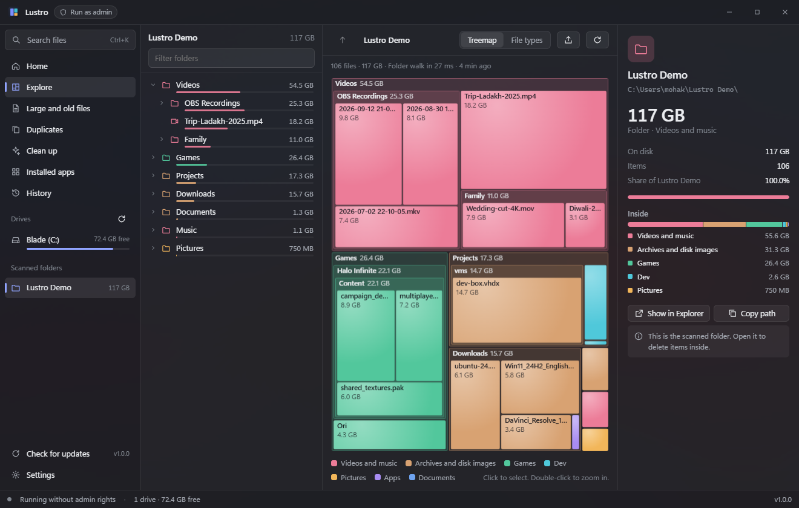
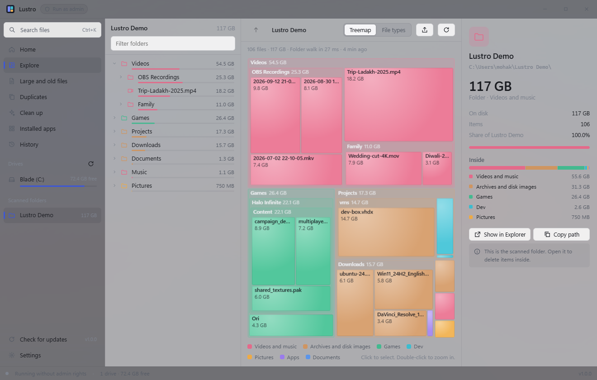
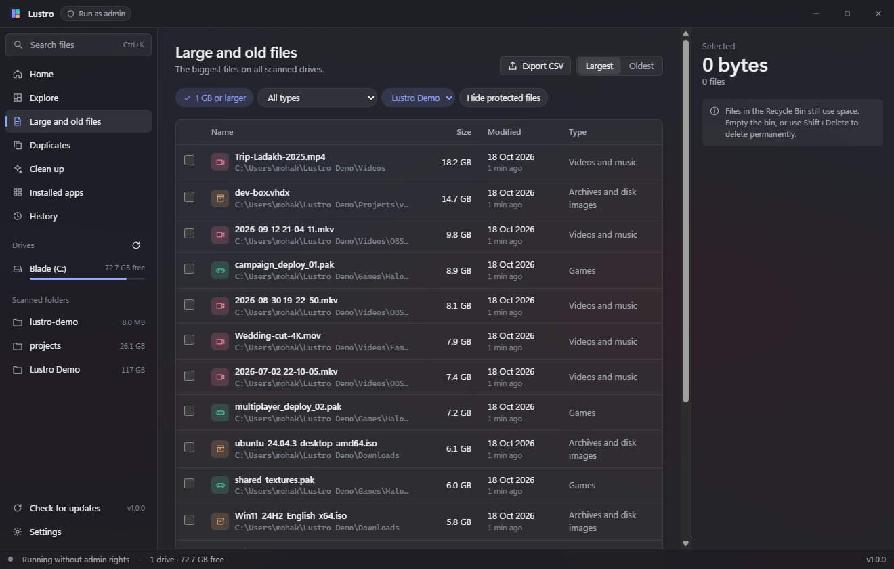
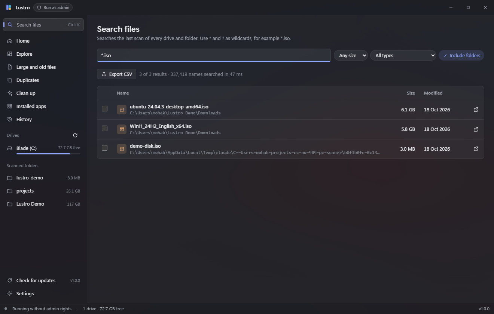

<p align="center"></p>

# Lustro

Lustro is a free and open source storage manager for Windows 11. It scans your drives, shows what uses the space, and helps you remove what you do not need.

*Lustro* is Latin. It means "I purify" and also "I survey".



## Features

- **Fast scan.** As administrator, Lustro reads the NTFS Master File Table directly: 2.2 million files in about 13 seconds. Without admin rights, it walks the folders.
- **Explore.** A folder tree sorted by size, a treemap that you can zoom into, a file type view, and a detail pane.
- **Large and old files.** The biggest files and the files that nobody changed for more than a year, over all scans.
- **Duplicates.** Files with the same size and the same BLAKE3 hash. Hard links count once. Lustro selects extra copies only of photos, videos, music, documents and archives outside program folders.
- **Clean up.** Temp files, Windows Update cache, crash dumps, browser caches, the Recycle Bin, and dev junk: old `node_modules` and `target` folders, npm/pip/Cargo/NuGet caches, Docker images, WSL disks, IDE caches. You review every item first.
- **Installed apps.** Size, install date and last use of desktop and Store apps. Uninstall runs the app's own uninstaller.
- **Search.** Names in all scans, with `*` and `?` wildcards. 2 million names in less than 0.1 seconds.
- **Live updates.** As administrator, the NTFS change journal keeps fast scans current without a rescan.
- **Safe delete.** Recycle Bin by default, a history with restore, and protected system paths that Lustro never deletes.
- **Windows integration.** Tray icon, low space alert, start with Windows, and "Analyze with Lustro" in the File Explorer menu (all optional).
- **Export.** CSV lists and an HTML report of a scan.

| Light theme | Large and old files | Search |
|---|---|---|
|  |  |  |

## Install

Download `Lustro-Setup-x.y.z.exe` from [Releases](https://github.com/AnonMohak/lustro/releases) and run it. The installer needs no admin rights. You can choose the folder, a desktop shortcut, start with Windows and the Explorer menu entry. Lustro updates itself from GitHub Releases (you can turn this off in Settings).

The release also has `Lustro_x.y.z_x64-setup.exe`. It is the update package that Lustro downloads by itself.

> **SmartScreen warning.** The installer is not code-signed yet, so Windows may show "Windows protected your PC". Choose **More info**, then **Run anyway**.

## Admin rights

Lustro starts as a normal user. Use **Run as admin** in the title bar to restart it with admin rights. You need them for:

- the fast MFT scan and live updates,
- folders that Windows hides from normal users (for example `System Volume Information`),
- the system junk in `C:\Windows` (Windows temp, Windows Update cache, Windows.old).

Everything else works without admin rights.

## Safety

- Lustro never deletes protected paths: `C:\Windows`, `Program Files`, the page file, drive roots, user profile folders and similar. The backend checks every path before it deletes.
- One exception, off by default: as admin, with Settings > "Allow deleting app folders" on, you can delete app and game folders inside `Program Files`. Each delete shows a warning that you must confirm. Windows' own folders there (for example `WindowsApps`) stay protected.
- Delete moves items to the Recycle Bin. A permanent delete always asks first.
- Lustro removes junctions and symbolic links as links. It never deletes the files that they point to.
- The cleaner deletes caches and temp files permanently. Apps make them again.

## Privacy

Lustro has no account, no telemetry and no ads. The only network request is the update check to GitHub, which you can turn off. Scans, history and settings stay in `%LOCALAPPDATA%\com.anonmohak.lustro`.

## Build from source

You need Windows 11, [Rust](https://rustup.rs) (MSVC toolchain), Node.js 22 or later, and the Visual Studio C++ build tools.

```powershell
npm install
npm run tauri dev     # run the app in dev mode
npm run tauri build   # make the installer in src-tauri/target/release/bundle/nsis
npm run build:setup   # put it in the themed installer: src-tauri/target/release/bundle/setup
npm run setup:dev     # run the themed installer window in dev mode
npm test              # frontend tests
cd src-tauri; cargo test
cd ../setup/src-tauri; cargo test
```

The themed installer (`setup/`) is a small Tauri app. It holds the NSIS installer, runs it without a window, and then applies the options. A copy of it in the install folder is the uninstaller.

`npm run tauri build` also signs the update package, so it needs the updater key in `TAURI_SIGNING_PRIVATE_KEY`. Without the key, build with `npm run tauri build -- --config src-tauri/tauri.ci.conf.json`.

If the Rust build fails with `link.exe` errors, another `link.exe` (from Git, Cygwin or MSYS) is earlier in your `PATH` than the MSVC linker. Remove those folders from `PATH` in that terminal, or build from a "Developer PowerShell for VS".

Some tests need admin rights and are ignored by default. Run them in an elevated terminal:

```powershell
cd src-tauri
cargo test --profile perf -- --ignored usn_sees_new_file mft_matches_walk --nocapture
```

## Screenshots

The README screenshots show a demo folder, not real user data. `scripts/make-demo.ps1 -Root "C:\Users\you\Lustro Demo"` makes that folder from sparse files: about 117 GB in size, but almost no space on the disk. Scan it with "Scan a folder", then delete it.

## Release

Push a tag like `v1.0.1`. The release workflow builds the installer, signs the update package, and makes a draft release with `latest.json`. Publish the draft on GitHub; then installed copies update.

## Logo

The logo is an "L" of two tiles with a sparkle: the treemap and the clean-up in one mark. The source is `src/assets/logo.svg` (a copy is in `branding/lustro-logo.svg`). After a change, run `npm run icons`: the app, the window, the tray and the installer all use this one file. `branding/social-preview.png` is the GitHub social preview.

## Tech

Tauri 2, Rust, React, TypeScript. The open and optional work is in [`PLAN.md`](PLAN.md); the original design mockup is in [`mockup/index.html`](mockup/index.html).

## License

[MIT](LICENSE)
